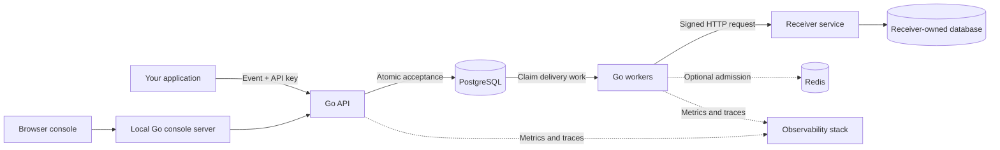

# RelayForge

**Reliable webhook delivery, with a clear view of every handoff.**

RelayForge moves events from one application to another, keeps a durable record of the work, and retries deliveries when a receiver is temporarily unavailable. It includes a tenant-authenticated API, background delivery workers, a signed example receiver, and a browser console for managing the whole flow.

For example, an online store can publish `order.created` once. RelayForge records the event, sends it to subscribed services, and shows whether each service acknowledged it. If a service is down, delivery can be retried without asking the store to rebuild its order event.

## Try the no-login demo

```sh
make run-demo
```

Open **http://127.0.0.1:8091**. Requires Go; no database, Docker, API key, account, or external service is needed. If another console is using port 8091, use `DEMO_ADDR=127.0.0.1:8105 make run-demo`.

Click **Send sample event** to watch a signed HTTP delivery, or **Try a retry** to see HTTP 503 followed by a successful retry. Each visitor gets an isolated temporary workspace automatically.

| Mode | Data | Destinations | Setup |
| --- | --- | --- | --- |
| Public playground (`cmd/demo`) | In memory; expires after 30 minutes or restart | Fixed built-in receiver | One Go process, no login |
| Full backend (instructions below) | Durable PostgreSQL storage | Configurable webhook endpoints | Database, API, worker and tenant API key |

The playground allows 10 events per workspace, 16 KiB per event, and up to 128 active visitors. It demonstrates real HTTP signing, delivery and retry, but does **not** provide the full backend’s durability or replay guarantees. Use sample data only. **End demo** deletes the current workspace.

For deployment without a purchased domain or external credentials, see [free demo deployment](docs/deploy-free.md). Optional account-based deployment is documented separately in [account deployment](docs/deploy-accounts.md).

## Contents

- [Features](#features)
- [Architecture](#architecture)
- [Technology](#technology)
- [Run locally](#run-locally)
- [Send your first event](#send-your-first-event)
- [Delivery guarantees](#delivery-guarantees)
- [Configuration and credentials](#configuration-and-credentials)
- [Testing](#testing)
- [Repository layout](#repository-layout)
- [Documentation](#documentation)
- [Limitations and next steps](#limitations-and-next-steps)
- [Push to GitHub](#push-to-github)

## Features

These features describe the full PostgreSQL backend. The lightweight playground above is a separate demonstration mode.

- **Durable acceptance:** event storage, delivery fan-out, and the idempotency receipt commit together in PostgreSQL before the API returns `202 Accepted`.
- **Tenant isolation:** API keys authenticate each workspace; resource queries are scoped to that tenant.
- **Endpoint management:** subscribe to event types or `*`, pause/enable endpoints, rotate signing secrets, and delete endpoints while retaining history.
- **Signed delivery:** outbound requests carry HMAC signatures; signing secrets are encrypted at rest.
- **Background processing:** workers claim bounded leases, send outside database transactions, and fence completion with claim tokens.
- **Failure recovery:** bounded retries, expired-lease recovery, dead-letter states, attempt history, and explicit replay.
- **Receiver deduplication example:** signature verification and a receiver-owned transaction prevent duplicate business effects for the same trusted source/event.
- **Admission controls:** PostgreSQL-backed backlog and in-flight bounds, with optional distributed token-bucket admission through Redis.
- **Operational visibility:** private health/metrics listeners, OpenTelemetry traces, and optional Prometheus, Grafana, and Jaeger services.
- **Public accounts:** Supabase GitHub sign-up, OAuth sign-in, isolated workspaces, and integration API-key creation/revocation.
- **Browser console:** publish events, manage endpoints, filter deliveries, inspect attempts, and replay failures. Live refresh, current-page statistics, and activity charts accompany the red-and-white responsive design.

## Architecture



The code is a modular monolith shared by separate API, worker, admin, migration, console, receiver, and hosted web gateway executables. PostgreSQL is both the durable event store and delivery queue. Redis is optional; it does not own accepted events.

The console uses a Go backend for frontend (BFF). The browser communicates with that server, which holds the tenant key in a short-lived session and calls the API. Static HTML, CSS, JavaScript, and SVG assets are embedded in the console binary; there is no frontend build pipeline.

## Technology

| Area | Implementation |
| --- | --- |
| Backend | Go 1.27.2, standard `net/http` |
| Durable storage and queue | PostgreSQL 18.6, pgx v5 |
| Migrations | Goose, embedded SQL migrations |
| Optional dispatch admission | Redis, go-redis |
| Console | HTML, CSS, vanilla JavaScript, embedded Go assets |
| Telemetry | OpenTelemetry, Prometheus, Grafana, Jaeger |
| Public identity | Supabase Auth (GitHub and email codes) |
| Deployment | Docker image, Render Blueprint, managed PostgreSQL |
| Development infrastructure | Docker Compose, Make |
| Verification | Go tests/race detector, real PostgreSQL/Redis integration tests, Python smoke scripts, Node built-in UI tests |

Exact Go dependency versions are pinned in [go.mod](go.mod); container versions are in [deploy/compose.yaml](deploy/compose.yaml).

## Run locally

The following steps run the full backend. For the simpler playground, use `make run-demo` above.

### Prerequisites

- Go **1.27.2** as pinned in `go.mod`.
- Docker with Compose, Git, and Make.
- Python 3 for secret generation and smoke/benchmark scripts.
- Node.js with the built-in test runner only if running the optional console UI tests. Node is not needed to run the application.

Run every command below from the repository root.

### 1. Configure your environment

```sh
cp .env.example .env
```

Edit `.env`:

1. Replace `POSTGRES_PASSWORD` and the matching password in `DATABASE_URL` with your own local password. URL-encode reserved characters in the database URL.
2. Generate an encryption key and put the output in `ENCRYPTION_KEY`:

   ```sh
   python3 -c 'import secrets,base64; print(base64.b64encode(secrets.token_bytes(32)).decode())'
   ```

Keep this key across restarts: the API and worker need the same value to decrypt stored signing secrets. Do not replace a key for an existing database casually. `.env` is ignored by Git.

If port `5432` is occupied, change `POSTGRES_HOST_PORT` and the port in `DATABASE_URL` to the same free port, such as `15432`.

### 2. Start storage, migrate, and build

```sh
make dev-up
make migrate-up
make build
make admin ARGS='tenant-create --name Demo'
```

The admin command prints a tenant ID, key ID, and **one-time API key**. Save the key privately. No shared API key or default user password is shipped with the project.

### 3. Start the application

Use separate terminals in the project directory:

```sh
make run-api
```

```sh
make run-worker
```

```sh
make run-console
```

Open **[http://127.0.0.1:8091](http://127.0.0.1:8091)** and connect with your tenant API key. Use the exact configured address. The console intentionally validates its host/origin.

| Service | Default address |
| --- | --- |
| Public API | `http://127.0.0.1:8080` |
| Browser console | `http://127.0.0.1:8091` |
| Worker private operations | `http://127.0.0.1:8081` |
| API private operations | `http://127.0.0.1:9091` |
| Optional example receiver | `http://localhost:8090/webhooks` |

Check readiness:

```sh
curl -i http://127.0.0.1:8080/health/ready
curl -i http://127.0.0.1:8081/health/ready
```

`make local-api`, `make local-worker`, and `make local-console` run existing `bin/` executables without rebuilding. Run `make build` first after cloning or changing source. Embedded UI changes require restarting the console after rebuilding.

To stop a process, use Ctrl+C in its terminal. `make dev-down` stops the Compose services while preserving database volumes.

## Send your first event

### Register a destination

In the console, open **Endpoints**, add your receiver's HTTPS URL, and subscribe to `order.created`. Save the signing secret displayed once and configure your receiving application to verify signatures.

For a fully local demonstration, use the included signed receiver. It needs a **separate receiver database**, receiver migrations, `RECEIVER_SECRETS`, and a stable `RECEIVER_SOURCE`. Set `DEV_RECEIVER_URL=http://localhost:8090/webhooks` in development before starting API/worker, then register that exact URL. Follow the full [receiver setup](docs/replay-and-receiver.md) and [console demo](docs/product-interface.md). Arbitrary private-network destinations are blocked.

### Publish through the console

Open **Events**, enter `order.created` and sample data, generate an idempotency key, and publish:

```json
{
  "order_id": "DEMO-001",
  "item": "Notebook",
  "quantity": 1
}
```

Open **Overview** to follow the delivery. A healthy receiver produces a delivered status and an HTTP acknowledgment in the attempt history. An event without matching endpoints is still accepted, with zero deliveries.

### Publish through the API

Set `TENANT_KEY` in your current shell to the private key returned by the admin command, then:

```sh
curl -i http://127.0.0.1:8080/v1/events \
  -H "Authorization: Bearer $TENANT_KEY" \
  -H 'Content-Type: application/json' \
  -H 'Idempotency-Key: demo-order-001' \
  --data '{"type":"order.created","data":{"order_id":"DEMO-001","item":"Notebook","quantity":1}}'
```

A successful acceptance returns `202` with `event_id`, `delivery_count`, and `accepted_at`. Acceptance means the work was committed, not that a receiver has already processed it. Retry an uncertain request with the **same idempotency key and exact request bytes**.

The [OpenAPI contract](api/openapi.json) documents endpoints, request/response shapes, and errors. See [ingestion](docs/ingestion.md) for pagination and the complete idempotency contract.

## Delivery guarantees

These guarantees apply to the PostgreSQL backend, not the temporary in-memory playground.

- **At least once:** network ambiguity can cause duplicate requests. Receivers must deduplicate where duplicate effects matter.
- **Atomic acceptance:** the event and matching delivery rows persist together before a successful response.
- **Immutable delivery bytes:** retries and replay use the saved event envelope instead of reconstructing it from a JSON view.
- **Tenant-scoped idempotency:** matching keys and exact input bytes replay the stored acceptance within the seven-day TTL. Changed bytes return a conflict; expired keys can create a new event.
- **Fenced worker completion:** stale workers cannot overwrite a newer claim's database state. This does not undo a remote effect that already happened.
- **Bounded failure handling:** retry/age limits eventually stop automatic attempts; replay creates a new delivery cycle and preserves history.

The example receiver demonstrates duplicate suppression within its own source/event transaction. RelayForge does not promise globally exactly-once HTTP delivery or global ordering. See [invariants](docs/invariants.md) and [replay semantics](docs/replay-and-receiver.md).

## Configuration and credentials

| Setting | Purpose |
| --- | --- |
| `DATABASE_URL`, `POSTGRES_PASSWORD` | Your local sender database credentials |
| `ENCRYPTION_KEY` | Base64-encoded 32-byte master key for stored signing secrets |
| Tenant API key | Generated once by the admin CLI; authenticates a workspace |
| Endpoint signing secret | Generated on creation/rotation; verifies outbound webhook signatures |
| `RECEIVER_DATABASE_URL`, `RECEIVER_SOURCE`, `RECEIVER_SECRETS` | Example receiver's independent storage and trusted sender namespace/keys |
| `RATE_LIMIT_ENABLED`, `REDIS_URL` | Optional distributed dispatch admission |
| `TRACE_ENDPOINT`, `TRACE_SAMPLE_RATIO` | Optional trace export configuration |
| `CONSOLE_ADDR`, `CONSOLE_API_URL` | Local console listener and upstream API |

Local development needs no external identity/email service. Public GitHub mode requires your Supabase Auth project, a GitHub OAuth app, and hosted PostgreSQL. No SMTP service or purchased domain is required. All application credentials are generated locally or supplied by the operator. API keys are hashed in storage; endpoint signing secrets are encrypted. The console keeps tenant keys in server memory with 30-minute sessions, CSRF protection, and no browser localStorage credential persistence.

Optional development services:

```sh
make dev-rate-up       # PostgreSQL + Redis
make dev-observe-up    # Also prepares/starts local observability services
```

Redis admission requires explicitly setting `RATE_LIMIT_ENABLED=true`. The development Grafana login defaults to `admin` / `relayforge-local-only` when `GRAFANA_ADMIN_PASSWORD` is blank; change it for your environment. These are local development services. See [configuration](docs/setup.md), [rate limits](docs/rate-limits.md), [observability](docs/observability.md), and [security review](docs/security-review.md).

## Testing

```sh
make test              # Unit tests
make test-race         # Go race detector
make lint              # Formatting check + go vet
make test-console-ui   # Five Node UI behavior tests; no npm installation
```

Database-backed checks require running local dependencies:

```sh
make test-console-smoke
make test-worker-smoke
make test-replay-smoke
```

Integration tests require explicit `INTEGRATION_DATABASE_URL` and `INTEGRATION_REDIS_URL` pointing to disposable local test infrastructure:

```sh
make dev-rate-up
make test-integration
```

See [test setup](docs/setup.md) for provisioning and constraints. Smoke scripts use disposable schemas and development-only safety guards. They cover real compiled processes, authentication/isolation, persistence, signing, recovery, replay, and Redis failures.

Benchmarks, query plans, profiles, and the recorded security scan are retained in [benchmarks](benchmarks/README.md). The measured short laptop runs are evidence for those workloads, not a production capacity guarantee or SLO. Reproduce them with `make benchmark`, `make benchmark-plans`, and `make benchmark-profile`.

## Repository layout

```text
api/                    OpenAPI specification
cmd/                    API, worker, console, admin, migration, receiver entrypoints
internal/               Domain logic, storage, HTTP handlers, security and telemetry
  console/assets/       Embedded HTML, CSS, JavaScript and SVG assets
migrations/             Sender and receiver SQL migrations
deploy/                 Development Compose and observability configuration
scripts/                Smoke checks, benchmarks and reporting helpers
tests/integration/      Real PostgreSQL/Redis integration scenarios
benchmarks/             Recorded results, query plans, profiles and methodology
docs/                   Setup guides, guarantees, runbooks and architecture decisions
.env.example            Safe configuration template
Makefile                Build, run and verification commands
```

Local `.env`, generated binaries, caches, logs, and editor files are excluded by `.gitignore`. There are no prebuilt executables in a source checkout.

## Documentation

| Guide | Covers |
| --- | --- |
| [Free public deployment](docs/deploy-free.md) | Render, Neon, Supabase Auth, OAuth, environment and live verification |
| [Setup](docs/setup.md) | Dependencies, environment variables and Make targets |
| [Architecture](docs/architecture.md) | Components, storage and process boundaries |
| [Accounts and endpoints](docs/accounts-and-endpoints.md) | Provisioning, API keys, subscriptions and rotation |
| [Ingestion](docs/ingestion.md) | Acceptance, validation, idempotency and read APIs |
| [Workers](docs/workers.md) | Dispatch, signatures, retry policy and outbound protection |
| [Replay and receiver](docs/replay-and-receiver.md) | Delivery cycles and transactional receiver deduplication |
| [Console](docs/product-interface.md) | Browser workflows and session security |
| [Runbook](docs/runbook.md) | Diagnose failures, inspect work and recover deliveries |
| [Security review](docs/security-review.md) | Implemented boundaries and remaining work |
| [Architecture decisions](docs/decisions/) | Design rationale and tradeoffs |
| [Original specification](docs/project-specification.md) | Original requirements, including planned work |

## Limitations and next steps

The core delivery system, red-and-white console, public account integration, Docker packaging, Render Blueprint, and verification tooling are implemented. The development console keeps API-key login on loopback. Production mode uses GitHub identity and HTTPS-origin checks. Dashboard statistics describe the current delivery page, not lifetime totals.

The [public deployment guide](docs/deploy-free.md) explains required Supabase, OAuth, PostgreSQL and Render setup. These external services must be configured and verified before sharing a deployment. Free Render services sleep: queued work persists, but delivery attempts pause until wake-up. Use always-on compute for continuous delivery.

Backups/restore drills, production egress policies, secret/key management, retention cleanup, shared sessions for multiple instances, and longer capacity/failure tests remain operator work. The development Compose stack is not production infrastructure. Read the current implementation guides rather than assuming every original specification item is complete.

## Push to GitHub

Create an empty repository on GitHub, then run these commands from this project's root. Replace the remote URL with your own repository URL:

```sh
git status --short
git add .
git diff --cached --stat
git commit -m "Initial RelayForge implementation"
git branch -M main
git remote add origin https://github.com/YOUR_USERNAME/relayforge.git
git push -u origin main
```

If `origin` is already configured, use that existing remote instead of adding it again. Commit source and `.env.example`; keep your real `.env`, binaries, and local backups private.
