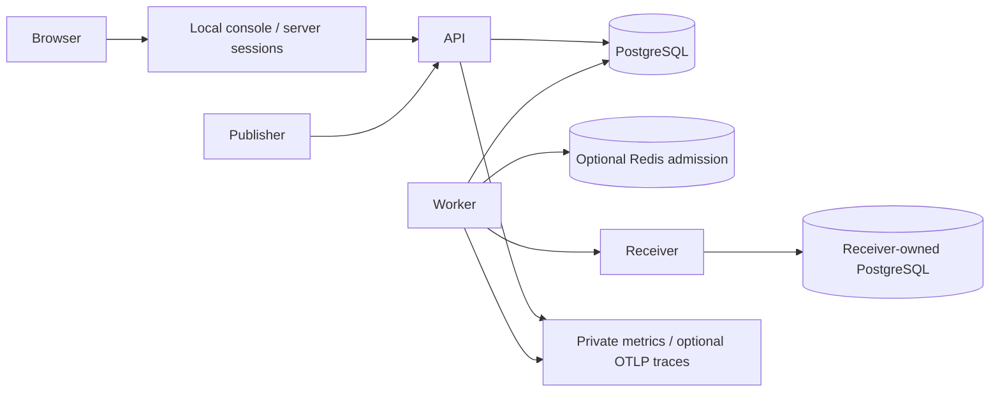

# Architecture

Status: API, ingestion, fenced worker dispatch, lease recovery, replay, and receiver transactional deduplication are implemented through milestone 10, including optional Redis admission, shared tenant scheduling/backlog caps, private metrics and linked traces.

The API authenticates tenant keys, manages endpoints, accepts events, and exposes history. A single acceptance transaction reserves an ingestion idempotency key, stores exact outgoing bytes, snapshots matching endpoints and URLs, creates delivery rows, and stores the response. A successful response means that transaction committed.

Workers claim due work using short PostgreSQL transactions and SKIP LOCKED. Claiming obtains optional bounded Redis admission before reserving an attempt, records a new lease token, and commits. Webhook network calls happen after commit. Redis denials/outages persist deferrals without attempts. Completion updates attempt and delivery together only while the token still owns the in-flight row. Workers now recover expired leases and sweep aged queued work in bounded endpoint-first transactions. Completed transient failures and abandoned attempts schedule finite-budget retries.

A lease is temporary permission to work. A fencing token distinguishes that permission from a newer claim, preventing an old worker from overwriting database state. It cannot undo an HTTP request: a receiver may have committed while the worker loses its response. Receiver transactional deduplication is therefore a separate responsibility.

Modules follow the specification's suggested layout. HTTP handlers call domain/services; PostgreSQL repositories enforce transactions and tenant-aware constraints. Inject clocks, randomness, IDs, and outbound HTTP where needed for deterministic failure tests. Use Go standard HTTP, pgx, parameterized SQL, and structured JSON logs. Official OpenTelemetry metric/trace SDKs expose private process metrics and optional bounded OTLP/HTTP export.

Operational dependencies stay private. Before endpoint APIs are deployed, outbound DNS validation and direct vetted-address dialing must prevent SSRF; production permits HTTPS/443 and no redirects or environment proxies. Development allows only an explicitly configured example receiver.

## Replay and receiver storage

The replay API locks endpoint then delivery and commits a new finite cycle together with a tenant/delivery/key audit record. It preserves the event/delivery IDs, raw bytes, URL snapshot, and historical attempts. Saved acceptance receipts remain stable after delivery progresses. See [replay contract](replay-and-receiver.md).

The example receiver has an explicit receiver-owned database URL and trusted source namespace. Its migration version table is independent of the sender's. A unique source/event marker and local demo business record commit in one transaction after signature verification. Receiver duplicates acknowledge without another business write; raw-body conflicts fail. Local smoke tests use separate sender/receiver schemas, without implying provisioned production ACLs.

## Tenant admission and fairness

PostgreSQL scheduler rows order eligible tenants by last selection and serialize per-tenant admission. Shared in-flight quotas bound one tenant's concurrent leases; locked tenants/endpoints yield their selection position. Ingestion/replay serialize backlog checks on the tenant row before endpoint/delivery locks. Existing idempotency receipts still return when backlog is full. Redis uses one Lua token bucket per deployment namespace/tenant; it never stores delivery work. See [rate limits](rate-limits.md) for defaults, clock assumptions, outage behavior, and limits.

## Operational plane

Public API traffic is separate from the loopback-only API operational listener; worker health/metrics also require loopback. API snapshots aggregate durable delivery state with an availability gauge; dashboards take max across API replicas to avoid double-counting global data. Histograms/counters are process-local best-effort observations with bounded labels. IDs appear only in structured logs/traces and authenticated history views.

Original acceptance span context is stored transactionally in event_trace_context, independently of outgoing bytes. Dispatch starts a new root with an OpenTelemetry link to that span; completion is its child. Public incoming propagation headers are ignored, and no internal context/baggage is sent to receivers. Exporter outages are noncritical and sanitized; PostgreSQL/schema and configured Redis remain critical readiness dependencies. The local monitoring profile is a reproducible ephemeral demo, not a production deployment.

## Product interface

A separate development-only console process serves embedded HTML/CSS/JavaScript and a narrow loopback BFF. The browser exchanges an API key once for an opaque short-lived cookie; credentials remain in bounded process memory and normal API authentication runs on every operation. Exact Host/Origin checks, CSRF tokens and restrictive CSP guard browser requests. No additional tables, migrations, frontend dependencies or backend API contracts are introduced. See [interface](product-interface.md) and [ADR 0011](decisions/0011-local-console-sessions.md).

## Measured query hardening

A partial tenant/endpoint/next-attempt index prevents a target claim from scanning another endpoint’s earlier work. Stable statement-time due predicates permit index range conditions; fresh database-clock cycle/lease checks after locking remain. Admission counts only enough live rows to decide whether complete fan-out fits under the tenant lock. See [ADR 0012](decisions/0012-measured-query-bounds.md), [benchmark report](../benchmarks/README.md), and [security review](security-review.md). Global telemetry snapshots still aggregate history; no production-scale rollup or capacity claim is implied.
