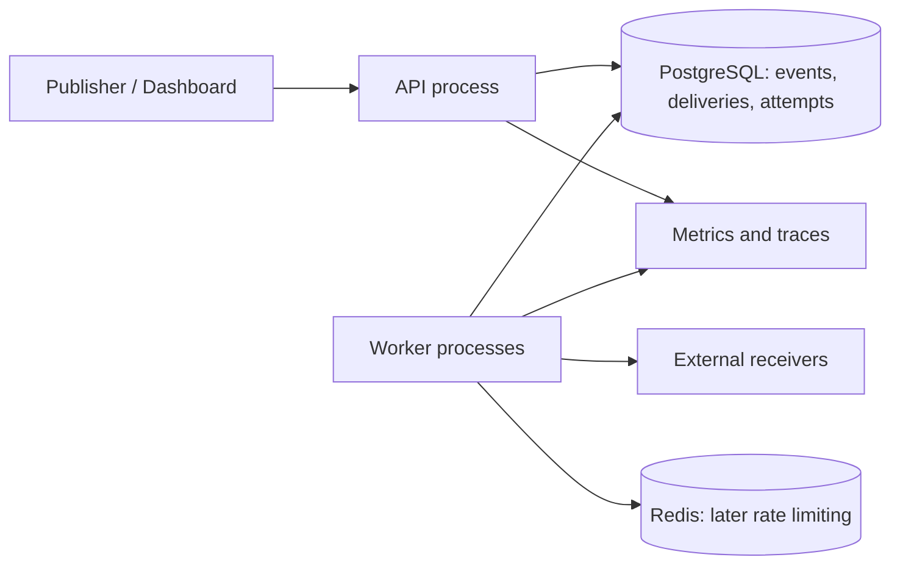

# RelayForge — Reliable Webhook Delivery Platform

> A final-year CSE project and backend SDE portfolio project. This document is the implementation specification, learning roadmap, acceptance checklist, and reusable prompt for ChatGPT. It describes a proposed system; it does not claim that anything has already been built or benchmarked.

## 1. How to use this document with ChatGPT

Upload this README into a fresh ChatGPT conversation and send the master prompt in section 2. Work through one milestone at a time. Keep this README, the repository, and a progress log as the durable source of truth. When the conversation becomes long, start a new chat with this README, the latest progress log, and relevant source files. Never assume the next chat can see earlier code.

If ChatGPT has no filesystem or terminal access, ask it to provide complete files and commands, run them yourself, and paste the actual results back. Do not accept statements that tests passed unless someone actually ran them.

Default implementation language: Go. If you prefer Java, decide before milestone 1 and translate the design consistently; do not mix backend implementations.

## 2. Copy-and-paste master prompt

```text
Act as my senior backend engineer and patient technical mentor. Help me implement RelayForge using the attached README as the project specification.

My objective is a working, deployed, well-tested portfolio project that I can explain independently in SDE interviews. Teach the reasoning behind transactions, leases, retries, idempotency, security, and failure recovery. I am a fourth-year CSE student; explain unfamiliar concepts clearly without hiding important tradeoffs.

Use Go, PostgreSQL, Docker Compose, and OpenTelemetry. Add Redis only in the later distributed rate-limit milestone. PostgreSQL is the durable source of truth and the initial delivery queue. Use a modular monolith with separate API and worker processes. Do not introduce Kafka, Kubernetes, or microservices without a demonstrated requirement.

First read the entire README. Summarize the architecture and begin milestone 0. Work on only one milestone at a time, and divide it into small tasks. For every task:
1. State its purpose and acceptance criteria.
2. Explain the design and important alternatives briefly.
3. Identify the exact files to create or edit.
4. Provide complete runnable code, or make the edits if you have workspace access.
5. Give commands to run, prerequisites, and expected results.
6. Add meaningful tests, especially concurrency and failure tests where required.
7. Run checks when possible; otherwise mark them explicitly as not run.
8. Explain failures and fix them before advancing.
9. Update docs/progress.md with decisions, changed files, verification evidence, and the next task.
10. End with a concise explanation of what I should understand before moving on.

Do not generate the entire project in one response. Do not leave placeholders in completed functionality. Never invent benchmark results, external credentials, dependency versions, deployment URLs, or test outcomes. Verify library APIs and choose supported dependency versions when implementation begins; pin them in module and container files. If this environment cannot verify something, state the limitation.

Follow the delivery state machine, tenant isolation, immutable payload rules, transactional acceptance, lease fencing, SSRF protections, and finite retry semantics in the README. Do not claim exactly-once delivery. Distinguish implemented features from planned features.

Use dependency injection for clocks, randomness, outbound HTTP, and identifiers when it improves deterministic testing. Keep functions cohesive, errors explicit, configuration validated, secrets out of logs, and comments focused on why. Prefer understandable code over unnecessary abstractions.

Ask questions only when a decision materially blocks implementation. Otherwise follow the README defaults and record assumptions. After the current milestone passes its checks, summarize it and wait for me to say 'continue' before starting the next milestone.
```

### Follow-up prompts

- **Continue:** “Continue with the next incomplete milestone. Read docs/progress.md first and preserve earlier decisions.”
- **Debug:** “Here are the command, full error, relevant files, and environment. Find the root cause, explain it, make the smallest correct fix, and rerun the affected checks.”
- **Review:** “Review this milestone against the README. Focus on correctness, races, security, and missing failure tests. Cite file locations and propose concrete fixes.”
- **Learn:** “Explain this component with one normal execution and one failure execution. Ask me three interview questions about its tradeoffs.”
- **Resume in a new chat:** “Read this README and progress log. Summarize completed work, unresolved issues, and the next task before editing.”

## 3. Problem, users, and scope

Businesses need to notify external systems about events such as order creation, subscription changes, or completed exports. Receiving systems may be unavailable, slow, or misconfigured. A sender may crash after the receiver accepts an event but before recording success. Clients may retry event submission after losing the response.

RelayForge accepts an event durably, creates delivery records for matching endpoints, and sends signed HTTP requests using background workers. It exposes delivery history and lets operators replay failed deliveries.

Users:
- Developers registering endpoints and publishing events through an API.
- Operators diagnosing delivery failures and replaying dead-lettered work.
- Receiver developers verifying signatures and preventing duplicate side effects.

Initial scope: JSON events, HTTP POST delivery, multiple tenants, multiple endpoints per tenant, event-type subscriptions, bounded retries, and an example receiver. Support both a CLI/curl workflow and a small dashboard later.

Non-goals for version 1: payments processing, a public signup/billing service, arbitrary customer code execution, strict ordering, exactly-once delivery, multi-region replication, and a custom message broker.

## 4. Explicit guarantees and limits

- A successful event-acceptance response means the event and its matching delivery rows committed to PostgreSQL.
- Deliveries use **at-least-once attempts within a finite retry policy**. An unavailable receiver can exhaust that policy and move to dead letter; eventual success is not unconditional.
- Duplicates are possible, especially after ambiguous timeouts and worker crashes.
- There is no global or per-endpoint ordering guarantee.
- Every delivery and attempt belongs to one tenant. Cross-tenant access must fail without exposing another tenant's data.
- Matching endpoints are snapshotted when an event is accepted. Newly registered endpoints do not receive historical events automatically.
- Stored outgoing bytes never change during automatic retries or replay.
- A 2xx response means the receiver acknowledged the request; it does not prove completion of downstream business processing.
- Worker leases reduce overlapping work; they cannot eliminate duplicate network requests during failures.
- Retention bounds how long history and idempotency records remain available.

## 5. Architecture



Use one repository and shared domain/service packages. Run API and workers as separate binaries so they can scale independently. Start with polling PostgreSQL; notifications may later reduce polling latency but must never become the durable queue.

### Why PostgreSQL first?

Atomic event acceptance and delivery creation avoid a database/broker dual-write problem. `FOR UPDATE SKIP LOCKED` supports queue-like consumers without waiting on rows held by another claimant. Keep transactions short and perform network calls outside locks. PostgreSQL explicitly documents this queue use case; it is not a generally consistent reporting query.

Redis is optional until distributed rate limiting. It must never be the only copy of accepted delivery work.

## 6. Suggested repository

```text
cmd/api/main.go
cmd/worker/main.go
cmd/receiver/main.go
cmd/admin/main.go
internal/config/
internal/auth/
internal/httpapi/
internal/events/
internal/endpoints/
internal/delivery/
internal/repository/postgres/
internal/signing/
internal/netpolicy/
internal/ratelimit/
internal/telemetry/
internal/testutil/
migrations/
api/openapi.yaml
tests/integration/
tests/e2e/
benchmarks/
deploy/compose.yaml
deploy/compose.observability.yaml
web/                         # optional dashboard
scripts/
docs/architecture.md
docs/decisions/
docs/progress.md
docs/runbook.md
docs/benchmark-report.md
.env.example
Makefile
README.md
```

Use Go's standard HTTP facilities or a small router, pgx for PostgreSQL, a migration tool, structured JSON logging, and official OpenTelemetry libraries. Use parameterized SQL. Choose and pin versions at implementation time.

## 7. Configuration defaults

These are project design defaults, not production guarantees. Validate ranges at startup.

| Setting | Initial default |
|---|---|
| API listen address | :8080 |
| Worker concurrency | 8 |
| Claim batch size | At most available worker slots |
| Queue poll interval | 500 ms, jittered |
| Outgoing request total timeout | 10 seconds |
| Delivery lease | 30 seconds |
| Lease recovery scan | 5 seconds |
| Maximum payload | 256 KiB of incoming request bytes |
| Maximum endpoints per tenant | 20 |
| Maximum endpoint URL length | 2048 characters |
| Total attempts per delivery cycle | 10, including first attempt |
| Retry base / cap | 2 seconds / 1 hour |
| Maximum delivery-cycle age | 24 hours |
| Retry-After maximum | 1 hour |
| Signature timestamp tolerance in sample receiver | 5 minutes |
| Ingestion idempotency retention | 7 days |
| Delivery/history retention | 30 days |
| Rate limit, later milestone | 10 outbound requests/second per tenant, burst 20 |
| Outgoing response body read limit | 4 KiB; discard by default |

Provide separate development and production profiles. Never use a global 'allow all private URLs' switch in production. The local receiver exception must be narrow and explicit.

## 8. Data model and constraints

Use UUID identifiers, UTC `timestamptz`, explicit migrations, foreign keys, and database constraints. Store outgoing JSON as `bytea` so signatures cover the exact bytes sent; optional JSONB may support inspection but must not be used to regenerate delivery bytes.

### tenants

`id`, `name`, `created_at`, `disabled_at`.

### api_keys

`id`, `tenant_id`, `key_prefix`, `key_hash`, `created_at`, `revoked_at`.

Generate a cryptographically random high-entropy token. Store a SHA-256 hash for lookup/verification, not the plaintext token. Display the token only on creation. Provision tenants through an admin CLI initially; do not ship a public unauthenticated tenant-creation endpoint.

### endpoints

`id`, `tenant_id`, `url`, `enabled`, `subscribed_event_types`, `created_at`, `updated_at`, `deleted_at`.

Use exact event-type matching plus an explicitly defined wildcard `*`. Keep history with soft deletion. Update URLs for future events only; existing deliveries retain their URL snapshot. Use composite uniqueness `(tenant_id, id)` to support tenant-aware foreign keys.

### endpoint_secrets

`id`, `tenant_id`, `endpoint_id`, `encrypted_secret`, `nonce`, `encryption_key_version`, `active_from`, `retire_after`.

Encrypt secrets with an authenticated encryption scheme such as AES-GCM and a server key supplied outside the database. Associate tenant, endpoint, and secret IDs as authenticated associated data. Do not store or log plaintext secrets. Secret rotation uses an overlap window described in section 13.

### events

`id`, `tenant_id`, `event_type`, `outgoing_body`, `body_sha256`, `created_at`, `expires_at`.

The server generates the stable event ID and creation time, then builds and stores the outgoing envelope once.

### ingestion_idempotency

`tenant_id`, `idempotency_key`, `request_hash`, `event_id`, `response_status`, `response_body`, `created_at`, `expires_at`.

Unique `(tenant_id, idempotency_key)`. Hash the validated incoming request's exact bytes. Document that whitespace or key-order changes count as different input for this implementation. Reject duplicate JSON keys and malformed/trailing JSON. Include event type and data in the hashed input. Key length: 1–128 printable ASCII characters.

### deliveries

`id`, `tenant_id`, `event_id`, `endpoint_id`, `url_snapshot`, `status`, `cycle_number`, `cycle_attempt_count`, `lifetime_attempt_count`, `next_attempt_at`, `cycle_started_at`, `lease_token`, `lease_expires_at`, `last_error_code`, `last_http_status`, `delivered_at`, `created_at`, `updated_at`.

Unique `(event_id, endpoint_id)`. Status CHECK constraint: `pending`, `in_flight`, `retry_scheduled`, `delivered`, `dead_letter`, `cancelled`. Counters must be nonnegative. Add tenant-aware foreign keys so a delivery cannot combine objects from different tenants.

### delivery_attempts

`id`, `tenant_id`, `delivery_id`, `cycle_number`, `attempt_number`, `lease_token`, `started_at`, `finished_at`, `outcome`, `http_status`, `latency_ms`, `error_code`.

Unique `(delivery_id, cycle_number, attempt_number)`. Outcomes include `started`, `success`, `retryable_failure`, `permanent_failure`, `lease_expired`, and `rate_limited` only if a request was actually attempted; local limiter deferrals should not create attempts. Leave started rows visible until completion or recovery.

### delivery_replays

`id`, `tenant_id`, `delivery_id`, `idempotency_key`, `new_cycle_number`, `created_at`.

Unique `(tenant_id, delivery_id, idempotency_key)`. Record replays independently of old attempts.

### Indexes

- Partial due-work index on `(next_attempt_at, id)` for pending/retry-scheduled deliveries.
- Partial lease-expiry index for in-flight deliveries.
- `(tenant_id, created_at DESC, id DESC)` for event/delivery listing.
- `(delivery_id, cycle_number, attempt_number)` for attempt history.
- Expiry indexes for bounded retention jobs.

Create explain-plan evidence for queue and listing queries using realistic seeded data. Avoid indexing every column.

## 9. API contract

All tenant routes require `Authorization: Bearer <api-key>`. Derive tenant identity from authentication, never trust a tenant ID in the body. JSON errors contain `code`, `message`, and `request_id`; no SQL errors or secrets.

| Method and path | Behavior |
|---|---|
| POST /v1/endpoints | Validate URL and subscriptions; create endpoint and initial secret; return 201 |
| GET /v1/endpoints | Cursor-paginated tenant endpoints |
| GET /v1/endpoints/{id} | Endpoint metadata, excluding secret |
| PATCH /v1/endpoints/{id} | Update future-event URL/subscriptions or enable/disable |
| DELETE /v1/endpoints/{id} | Soft-delete and cancel unfinished work under defined race semantics |
| POST /v1/endpoints/{id}/rotate-secret | Create secret, return it once, initiate overlap |
| POST /v1/events | Require Idempotency-Key; atomically accept event and matching deliveries; return 202 |
| GET /v1/events | Cursor-paginated events |
| GET /v1/events/{id} | Event and delivery summary |
| GET /v1/deliveries | Filter by status, endpoint, event; cursor pagination |
| GET /v1/deliveries/{id} | Delivery detail |
| GET /v1/deliveries/{id}/attempts | Paginated attempt history |
| POST /v1/deliveries/{id}/replay | Require Idempotency-Key; replay dead-letter delivery |
| GET /health/live | Process running; no dependency probe |
| GET /health/ready | Check critical dependencies with timeout |
| GET /metrics | Private operational interface, not public tenant data |

Return 400 for invalid JSON/fields, 401 for bad credentials, 404 for nonexistent or other-tenant resources, 409 for idempotency mismatch/invalid state, 413 for payload overflow, 429 for ingestion throttling, and 503 for unavailable durable storage. Include a request ID in responses. Do not acknowledge an event before commit.

Use keyset pagination, default 25 and maximum 100. Encode a versioned cursor containing sort values; validate it and use a stable timestamp-plus-ID order. Cap filter ranges. Do not return secret material in listing APIs.

### Event submission

```http
POST /v1/events
Authorization: Bearer <tenant-key>
Idempotency-Key: order-42-created-v1
Content-Type: application/json

{"type":"order.created","data":{"order_id":"42","amount_minor":12500,"currency":"INR"}}
```

```json
{"event_id":"<uuid>","delivery_count":2,"accepted_at":"<UTC timestamp>"}
```

Outgoing stored envelope:

```json
{"id":"<event UUID>","type":"order.created","created_at":"<UTC timestamp>","data":{"order_id":"42","amount_minor":12500,"currency":"INR"}}
```

Zero matching endpoints is allowed: persist the event and return delivery_count 0. This makes subscription configuration observable without inventing historical delivery behavior.

## 10. Atomic event acceptance and idempotency

1. Authenticate, enforce size limit, validate JSON and event type, and compute request hash.
2. Begin transaction.
3. Attempt to reserve the tenant/idempotency key with a uniqueness constraint. A concurrent request must converge through database conflict handling, not an in-memory check.
4. Existing unexpired key + same hash: return the originally stored status/body without creating work. Existing unexpired key + different hash: return 409.
5. Expired key: reuse only through a serialized transaction that safely replaces the expired record. Document that retries after seven days may create a new event.
6. For a new reservation, generate event ID, construct immutable envelope, insert event, select currently enabled matching endpoints, and insert delivery rows with URL snapshots.
7. Save response in the idempotency row and commit.
8. Return 202 only after successful commit.

Test commit success followed by lost HTTP response: repeating the key must return the original event. If commit outcome is ambiguous, instruct clients to retry the same key. Transactions need a consistent concurrency policy for endpoint changes; use one SQL snapshot for matching and document that concurrent registration may fall on either side of acceptance.

## 11. Worker claiming, leases, and recovery

State transitions:

```text
pending / retry_scheduled -> in_flight
in_flight -> delivered | retry_scheduled | dead_letter | cancelled
expired in_flight -> retry_scheduled | dead_letter
pending / retry_scheduled -> cancelled
 dead_letter -> pending (explicit replay, new cycle)
```

- Claim only as many rows as can start immediately. A claimed batch must not sit behind busy workers until leases expire.
- Use a short transaction with due rows selected `FOR UPDATE SKIP LOCKED`.
- Lock/check endpoint lifecycle consistently before authorizing a dispatch. Establish one lock order shared by disable/delete/claim code and test for deadlocks.
- Obtain any required rate-limit permission before creating an actual network attempt. Deferrals change scheduling without consuming attempt budget.
- On claim, generate a new fencing token, set lease expiry, increment attempt counters, and insert a started attempt in the same transaction.
- Commit before outbound HTTP.
- Complete through a conditional update where delivery ID, status=in_flight, and lease_token match. Update attempt and delivery together. A stale worker cannot change current state.
- Use bounded HTTP duration shorter than lease duration. If preparation can exceed that budget, extend the lease conditionally or redesign preparation; do not silently outlive it.
- A recovery loop locks expired leases, records an ambiguous lease-expired outcome, and schedules retry or dead letter within budget.
- A worker crash after remote acceptance may result in redelivery. Fencing protects database state, not remote side effects.
- A claim that crashes before sending still consumes a reserved attempt. Document this conservative accounting.
- Graceful shutdown: stop claims, finish active work within a bounded grace period, and let abandoned leases recover.

Disabling an endpoint holds future dispatches without consuming attempts; age limits still apply. Re-enabling resumes eligible work. Deleting cancels unfinished deliveries. Already authorized/in-flight requests may still finish after disable/delete: document this race, preserve history, and prevent new claims. No operation can recall an HTTP request already sent.

## 12. Retry policy and replay

Classify responses:
- Any 2xx: delivered.
- 408, 425, 429, and 5xx: retryable.
- Network timeout, temporary connection failure: retryable, potentially ambiguous.
- Other 4xx: permanent failure.
- 3xx: do not follow redirects; permanent failure for version 1.
- Invalid destination, forbidden resolved IP, or TLS validation failure: permanent failure until corrected/replayed through a documented path.

For failed attempt number n, use full jitter:

`delay = uniform(0, min(1 hour, 2 seconds * 2^(n-1)))`

Use overflow-safe arithmetic and injectable randomness. For 429/503, parse Retry-After seconds or HTTP date. Respect a valid value up to one hour, using the later of jitter delay and bounded Retry-After. Invalid values fall back to jitter. If the next retry would exceed the 24-hour cycle deadline or attempt budget, move to dead letter. Add a sweeper for aged pending/deferred deliveries too.

Replay only dead-letter deliveries. Lock the row, validate endpoint availability and event retention, deduplicate the replay request, increment cycle number, reset cycle counter/deadline, and enqueue immediately. Preserve event ID, delivery ID, immutable body, URL snapshot, and old attempts. Stable event identity lets receivers deduplicate previously processed events. Concurrent replay requests must not create multiple cycles. Replaying delivered/cancelled/in-flight work returns 409.

If an old URL is broken, version 1 requires a new event to route to the new URL; a future explicitly audited 'replay to new destination' feature may relax this. Do not silently rewrite snapshots.

## 13. Signing and receiver deduplication

Follow Standard Webhooks conventions and verify against published test vectors/library behavior before claiming compatibility.

Headers:
- `webhook-id`: stable delivery UUID, unchanged across retries/replay.
- `webhook-timestamp`: current Unix seconds, refreshed for every attempt.
- `webhook-signature`: one or more space-separated `v1,<base64 signature>` entries.

Signed bytes: `<webhook-id>.<webhook-timestamp>.<exact raw outgoing body>`.

Use HMAC-SHA256 and cryptographically random 32-byte secrets. If exposing `whsec_` encoded secrets, decode according to the specification before signing. Never reserialize JSON when verifying.

Sample receiver:
1. Read bounded raw body.
2. Validate timestamp within five minutes, including future skew.
3. Parse signatures and verify against active secrets with constant-time comparison.
4. Validate envelope and deduplicate by stable event ID within its own tenant/source namespace.
5. Commit processed-event marker and demo business side effect in the same database transaction.
6. Return 2xx for already-processed valid events.

A Redis marker followed by a separate database write is not atomic deduplication. For external side effects, explain the need for downstream idempotency or an outbox; do not promise exactly-once external actions.

Secret rotation: create a new secret, display once, and sign with old and new keys during an explicit 24-hour overlap. Receiver accepts either while migrating. Afterwards sign only with the new key. Existing queued deliveries use current active endpoint keys, not a secret frozen with the URL. Test rotation with a receiver that has only old, both, and only new secrets.

## 14. Security requirements

An outbound webhook service can become an SSRF proxy. Implement protection before deploying an endpoint-registration API publicly.

- Production: HTTPS only, port 443 initially, no userinfo, no fragments, no IP-literal destinations, and no redirects.
- Resolve destinations at connection time and reject loopback, private, link-local, multicast, unspecified, reserved, and cloud metadata ranges for both IPv4 and IPv6, including mapped-address tricks.
- Validate all DNS answers and dial a vetted resolved address directly while preserving the original hostname for TLS/SNI. Registration-only checks are insufficient because DNS can change.
- Use a dedicated outbound transport; disable environment proxy inheritance. Enforce TLS certificate validation and bounded connect/read/total timeouts.
- Add deployment egress restrictions as a second layer.
- Development exceptions: only the explicitly configured example receiver hostname/network, with the production profile rejecting these exceptions. Never authorize arbitrary private destinations.
- Revalidate destinations on every dispatch, including retries and replay.
- Avoid custom caller-supplied HTTP headers in v1; they introduce credential and hop-by-hop-header issues.
- Redact API keys, signing secrets, payloads, authorization headers, and response bodies from logs. Record status/error categories by default.
- Bound request size, response reading, concurrency, tenant endpoint count, and retention.
- Tenant-aware queries and constraints; test every object route against another tenant.
- Keep metrics/administrative routes private. If a dashboard uses cookie authentication, add CSRF protection; do not store long-lived keys in browser localStorage.
- Use secret environment injection locally and a secret manager in deployment. Encrypt signing secrets in the database; maintain backup access to the encryption key securely.

## 15. Distributed rate limiting, later phase

Add Redis after durable delivery behavior works. Use an atomic Lua token bucket keyed by tenant, with server-side time where practical. Explain burst capacity, refill, TTL, and clock assumptions.

Rate limiting is permission to send, not delivery success. A local deferral must not consume network-attempt budget. On denial, schedule the next eligible time without hot-looping. If Redis is unavailable, default to fail-closed outbound dispatch and keep events durable in PostgreSQL; expose degraded readiness/metrics and document the availability tradeoff.

Approximate fairness: avoid letting one large tenant monopolize every claim batch. Implement bounded per-tenant claim quotas and document that strict fair scheduling is not guaranteed. Test two tenants with very different queue sizes.

## 16. Observability

Structured logs: request_id, tenant_id where appropriate, event_id, delivery_id, attempt_number, cycle, worker_id, outcome, latency. Do not log payloads/secrets.

Metrics:
- Events accepted and rejected by bounded error category.
- Outbound attempts by outcome/status class.
- Pending/retrying/in-flight/dead-letter counts.
- Age of oldest eligible work.
- Acceptance latency, outbound attempt duration, first-attempt queue delay, and event-to-acknowledgment duration.
- Lease expirations, stale completion rejections, replay counts, rate-limit deferrals.

Avoid event/tenant/URL labels in metrics because they create unbounded cardinality. Use logs/traces for individual objects. Propagate internal trace context deliberately; do not leak internal baggage to arbitrary receivers. Connect asynchronous spans with stored trace context or links.

Dashboards should answer: Is acceptance healthy? Is backlog growing? Which failure categories dominate? Are leases expiring? Is rate limiting the bottleneck?

## 17. Tests and failure experiments

### Unit tests

Backoff bounds and attempt numbering; Retry-After parsing; status classification; state transitions; signature vectors; tampered body; old/future timestamp; secret overlap; URL/IP policy; cursor validation; configuration validation. Use fake clock/randomness and deterministic cases.

### PostgreSQL integration tests

Use real PostgreSQL, not SQLite substitutions. Cover migrations, transaction rollback, simultaneous same-key requests, mismatched keys, zero matching endpoints, endpoint subscription snapshots, composite tenant constraints, multiple claimers, stale-token rejection, lease recovery, concurrent replay, and retention.

### End-to-end scenarios

1. Healthy receiver acknowledges one event.
2. Receiver returns 500 twice, then 200; retry schedule/history correct.
3. Receiver stays down; work survives API and worker restarts.
4. Receiver commits effect but delays response; retry arrives and effect remains single.
5. Kill worker after receiver acknowledgment but before completion persistence; lease recovery produces a duplicate, safely deduplicated by receiver.
6. Ten concurrent ingestion requests with one key produce one event and one delivery per matching endpoint.
7. Multiple workers race; only one valid lease controls database completion.
8. Permanent 400 dead-letters immediately; replay starts exactly one new cycle.
9. 429 with Retry-After delays appropriately.
10. Redirects, private DNS results, IPv6 bypasses, and DNS rebinding simulation are blocked.
11. Tenant A cannot read/update/replay tenant B objects.
12. Secret rotation succeeds across overlap and rejects retired keys afterwards.
13. Database outage prevents acceptance acknowledgment; same-key retry recovers after restoration.
14. Redis outage defers dispatch without losing events or consuming attempt budgets.
15. Graceful shutdown and abrupt kill both recover within documented bounds.
16. Disable/delete race matches documented lifecycle behavior.

Add deterministic failpoints in test builds around claim, send, and completion. Keep them inaccessible in production. Do not rely solely on sleeping and hoping to hit a race. Run Go race detector for relevant concurrency code.

## 18. Milestones: implement in this order

Each task should fit approximately one focused work session. Estimates vary with experience; plan roughly 10–12 weeks, not a guaranteed deadline.

### Milestone 0 — Requirements and setup

Tasks: confirm Go choice; install/check toolchain and Docker; initialize repository; record versions; create architecture decision records; write invariants and progress log.

Acceptance: repository structure exists, README reflects chosen defaults, local prerequisites documented, and no secrets committed.

### Milestone 1 — Running skeleton

Tasks: config parsing; API/worker binaries; structured logging; health routes; Compose PostgreSQL; migration runner; shutdown handling; Make targets.

Acceptance: fresh checkout starts with documented commands; invalid config fails clearly; migration up/down tested on disposable database.

### Milestone 2 — Tenants, authentication, endpoints

Tasks: tenant/admin CLI; API key creation/revocation; auth middleware; endpoint CRUD/subscriptions; encrypted secrets; URL policy groundwork.

Acceptance: two tenants isolated; keys shown once; invalid URLs rejected; endpoint responses omit secrets except creation/rotation.

### Milestone 3 — Durable ingestion

Tasks: bounded JSON validation; immutable envelope; transaction; idempotency contention; fan-out; list/detail APIs.

Acceptance: duplicate/concurrent submissions create no extra events/deliveries; mismatch returns 409; rollback creates no partial work.

### Milestone 4 — Worker happy path

Tasks: claim transaction; attempts and lease tokens; bounded worker pool; safe outbound transport; signed delivery; completion fencing; healthy receiver.

Acceptance: two worker processes deliver work; network occurs outside database transaction; tenant and destination safety tests pass.

### Milestone 5 — Failure recovery

Tasks: retry classifier; jitter; Retry-After; expiry scan; cycle deadlines; dead letter; shutdown behavior; crash failpoints.

Acceptance: outage/restart and ambiguous-success tests pass; stale workers cannot overwrite newer state; finite budgets enforced.

### Milestone 6 — Replay and receiver correctness

Tasks: replay idempotency; replay history; receiver transactional deduplication; signature test vectors; key rotation.

Acceptance: replay preserves stable identity/body; old attempts remain; one business effect survives duplicate delivery.

### Milestone 7 — Rate limits and lifecycle races

Tasks: optional Redis bucket; deferral scheduling; basic tenant fairness; disable/delete semantics; backlog limits.

Acceptance: rate limits work across workers; Redis outage behavior verified; one tenant cannot trivially starve another in the chosen test.

### Milestone 8 — Operational visibility

Tasks: metrics; traces; dashboards; readiness/degraded behavior; private metrics exposure; runbook.

Acceptance: an operator can find an event, explain its failures, observe backlog, and replay through documented commands.

### Milestone 9 — Optional product interface

Tasks: small endpoint form; event publisher; delivery list/filter; attempt detail; dead-letter replay; secure server-side session/BFF if browser authentication is needed.

Acceptance: complete demo usable without direct database access; errors/loading states work; no browser-stored long-lived secrets. Finish backend correctness before UI polish.

### Milestone 10 — Benchmarks and hardening

Tasks: seed scripts; healthy/slow/failing receiver workloads; realistic load profiles; explain plans; profiling; security review; fix observed bottlenecks.

Acceptance: reproducible benchmark report with raw results, exact environment, limitations, and no fabricated claims.

### Milestone 11 — Deployment and portfolio

Tasks: container builds; CI; TLS deployment; private dependencies; migrations; backup/restore drill; demo script; screenshots; final architecture docs and resume bullets.

Acceptance: fresh setup works, hosted demo uses synthetic data, tests/CI pass, documented crash demo works, and deployment secrets remain private.

## 19. Development commands to implement

Create Make targets rather than claiming these exist now:

```sh
cp .env.example .env
make dev-up
make migrate-up
make seed-demo
make run-api
make run-worker
make run-receiver
make test
make test-integration
make test-e2e
make test-race
make lint
make benchmark
make dev-down
```

Define each target in documentation, including working directory and environment. Seed commands should be safe to repeat and must not overwrite production data. Destructive reset targets must clearly require a development database and explicit invocation.

## 20. Benchmark methodology

Treat performance as an experiment. Start with increasing ingestion rates such as 10, 50, and 100 events/sec, then increase only while the system remains stable. Vary fan-out separately: 1 event to 10 endpoints creates 10 deliveries. Rate limits may intentionally cap throughput; declare whether they are enabled and use enough tenants for meaningful testing.

Record:
- CPU, memory, OS, Go/PostgreSQL versions, worker count, database pool settings, network topology, payload size, endpoints/event, and tenant count.
- Warmup duration, measured duration, number of repetitions, achieved load versus offered load.
- Accepted events/sec and attempted/successful deliveries/sec separately.
- Ingestion p50/p95/p99, queue delay, HTTP duration, end-to-end acknowledgment latency.
- Backlog growth, time to drain, error rate, CPU/memory, lease expirations.
- Crash-to-recovery time and behavior during a receiver outage.

Do not hide failed/dead-lettered events by reporting latency only for successes; report censored/unfinished counts separately. Use an open-loop load generator or explain coordinated omission. Retain scripts and machine-readable results. Report local and hosted results separately.

Example resume template, fill only with measured values:

“Built a Go/PostgreSQL webhook delivery platform with transactional ingestion, fenced worker leases, signed payloads, and idempotent replay; sustained [X] deliveries/sec at [Y] p95 latency under [documented workload], and verified crash recovery using fault-injection tests.”

## 21. CI and deployment

CI: formatting check, vet/lint, unit tests, PostgreSQL integration tests, relevant race tests, build API/worker/receiver, dependency vulnerability checks, and container build. Pin action/dependency versions deliberately. Keep longer failure suites runnable separately if necessary, with documented status.

Deployment topology: one API container, one or more workers, private managed PostgreSQL, optional private Redis, TLS reverse proxy, and private telemetry. Start on a single host or modest managed platform; Kubernetes is optional future work.

Operational requirements:
- Non-root containers, minimal images, health probes, resource limits.
- Database connection budgets across all replicas.
- Migration job once per release; backward-compatible changes where possible.
- Secrets injected outside source control; backup the signing-secret encryption key securely.
- Database backups and a tested restore procedure.
- Egress restrictions and production SSRF enforcement.
- Alerts for sustained queue age, lease expiry, database failure, and dead-letter growth.
- No automatic schema rollback in production; document forward fixes and restore options.

Runbook: outage diagnosis, queue inspection, failed endpoint handling, safe replay, worker scaling, secret rotation, key revocation, retention, backup restoration, and rollback.

## 22. Retention and maintenance

Delete in bounded batches outside latency-sensitive paths. Retain live delivery work even when nominal history retention passes. Never delete an event while unfinished deliveries or required replay/history reference it. Keep ingestion response records for their documented TTL; after expiry, clients must expect key reuse may create new work. Keep receiver deduplication records at least as long as the sender's possible retry/replay window, or explicitly accept the resulting duplicate risk.

Expose retention policy clearly. Avoid infinite replay by requiring event availability and administrative retention limits. Cleanup must honor foreign keys and tenant boundaries.

## 23. Demo script

1. Provision two tenants and one endpoint each.
2. Publish an order.created event and inspect successful delivery/trace.
3. Repeat the same ingestion key and show the original event ID.
4. Make receiver return failures; observe retries and attempt logs.
5. Stop worker and receiver, enqueue work, restart them, and show recovery.
6. Trigger ambiguous acknowledgment/crash and show duplicate requests but one receiver-side business effect.
7. Exhaust retries, inspect dead letter, repair receiver, replay once.
8. Attempt cross-tenant access and a private-network destination; show rejection.
9. Present actual benchmark results and one documented design limitation.

Use a clearly labeled accelerated retry configuration for demos; do not present it as the production timing policy.

## 24. Interview preparation

Be able to answer:
- Why does event acceptance use one transaction?
- Why are ingestion idempotency and receiver deduplication separate?
- What happens if a worker crashes before sending? After remote success? Before committing completion?
- Why does a lease need a fencing token?
- Why can a fenced system still make duplicate HTTP requests?
- Why SKIP LOCKED instead of holding locks during HTTP calls?
- Why PostgreSQL queue first, and when would a broker become useful?
- What would require an outbox if a broker were introduced?
- What is the difference between attempt latency and end-to-end latency?
- How do retries create load amplification, and how does jitter help?
- Why is endpoint URL validation insufficient without safe connection-time DNS handling?
- How do signing and deduplication solve different problems?
- How does retention change idempotency guarantees?
- What breaks if strict per-endpoint ordering is required?
- Which bottleneck did measurements identify, and what evidence supports your optimization?

## 25. Final definition of done

- [ ] Fresh checkout can start using documented commands.
- [ ] API contract, migrations, configuration, and architecture agree.
- [ ] Durable atomic ingestion and concurrent idempotency verified.
- [ ] Multi-worker claiming, fencing, crash recovery, and retry budgets verified.
- [ ] Signed payloads, receiver deduplication, and rotation verified.
- [ ] Tenant isolation and SSRF protections tested.
- [ ] Dead-letter inspection and idempotent replay work.
- [ ] Operational metrics, logs, and runbook exist.
- [ ] CI passes with recorded evidence.
- [ ] Benchmarks are reproducible and accurately reported.
- [ ] Deployment and backup/restore procedure tested.
- [ ] Limitations and planned features are labeled honestly.
- [ ] You can explain the core code and failure paths without relying on ChatGPT.

## 26. References

These sources inform queue mechanics and interoperable signing; the project defaults and roadmap are design choices, not requirements copied from the sources. Verify supported APIs/versions when implementing.

- PostgreSQL SELECT and SKIP LOCKED: https://www.postgresql.org/docs/current/sql-select.html
- Standard Webhooks specification: https://github.com/standard-webhooks/standard-webhooks/blob/main/spec/standard-webhooks.md
- Standard Webhooks signature verifier: https://www.standardwebhooks.com/verify
- OSV API, useful for dependency checks: https://google.github.io/osv.dev/quickstart/

## 27. Progress log template

```markdown
# Project progress
## Current milestone
## Completed tasks
## Changed files
## Decisions and reasons
## Commands actually run and outcomes
## Tests not run and why
## Known bugs / unresolved risks
## Next small task
## Questions I should be able to answer
```

Keep the log concise and factual. The final project README should replace this implementation plan's proposed commands with verified instructions and link to the plan as a separate design document if needed.
